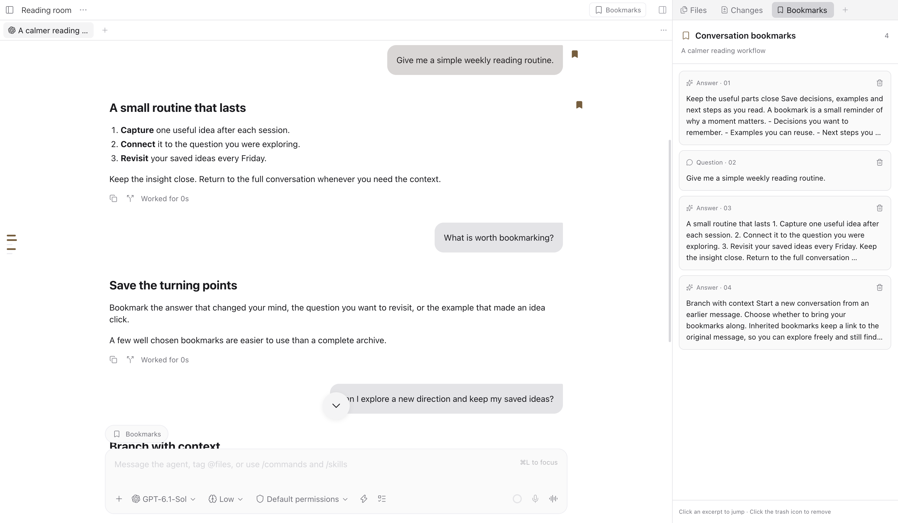

# Paseo conversation bookmarks

[简体中文](README.zh-CN.md)

Save questions and answers in Paseo, then find them from a right-hand bookmark panel or the conversation timeline.



## Features

- Bookmark a question or answer with one click.
- Read short excerpts in the right-hand panel, ordered by conversation position.
- Click an excerpt to return to the message and briefly highlight it. Remove bookmarks directly from the panel.
- Find bookmarked turns through gold ticks on the left timeline.
- Choose whether a forked conversation inherits the original bookmarks. Inherited bookmarks keep their source; removing one in the fork does not change the original.
- Reopen a closed source conversation when following a bookmark. If the source was deleted, keep the excerpt and show an unavailable message.
- Switch tabs or panes to cancel an earlier jump. With no conversation selected, the panel shows a selection prompt and keeps saved data intact.

[Preview the fork inheritance choice](assets/bookmarks-inheritance.en.png).

## Install

Requires Paseo **0.15.x** on desktop or web. The interface follows Paseo’s language setting, including “System”. English and Simplified Chinese are supported, with English as the fallback. Native mobile clients are not supported.

Install directly from this repository:

```sh
paseo plugin add git:sylviaxiang424/paseo-bookmarks
```

## Use

1. Hover over a message and click its bookmark icon. For answers it sits just below the leading divider; for questions it sits beside the bubble's upper-right corner. Saved icons stay gold.
2. Click **Bookmarks** in the workspace header to open the right panel.
3. Click an excerpt to jump, or the trash icon to remove it. Questions highlight only inside their bubble; answers highlight their text, excluding dividers and controls.
4. When branching into a new tab, choose **Inherit bookmarks** or **Do not inherit**.

## Data and compatibility

Bookmarks are stored on the connected daemon host at `$PASEO_HOME/plugin-data/paseo-bookmarks/bookmarks.json` (`~/.paseo` when `PASEO_HOME` is unset). They contain message identifiers, source information and a local text excerpt of up to 800 characters. Excerpts are not AI-generated. The plugin does not contact an external service or require an account or token. Uninstalling does not delete this data file.

The panel and navigation use Paseo's plugin API. Message buttons, timeline marks and precise jumps also depend on a compatibility adapter for Paseo 0.15.x. They may need updates when Paseo changes. Jumps wait for history to load and retry once if needed; an inaccessible source or an incompatible host interface can still prevent navigation.

## Development

```sh
npm ci --ignore-scripts
npm run typecheck
npm test
paseo plugin install /absolute/path/to/paseo-bookmarks
```

After editing, run the checks and reload with `paseo plugin reload paseo-bookmarks`. No separate build is required. Runtime dependencies are provided by Paseo.

With Tabbit and its CLI installed, `npm run test:layout` checks actual browser geometry, scrolling and focus at three pane widths. Set `TABBIT_CLI` if the launcher is outside `~/.local/bin`.

`client/` contains the panel, navigation and web adapter; `server/` handles local storage; `shared/` defines the data and RPC contracts. Tests cover persistence, fork inheritance, direct removal, layout bounds and navigation through unloaded or remounted history.
