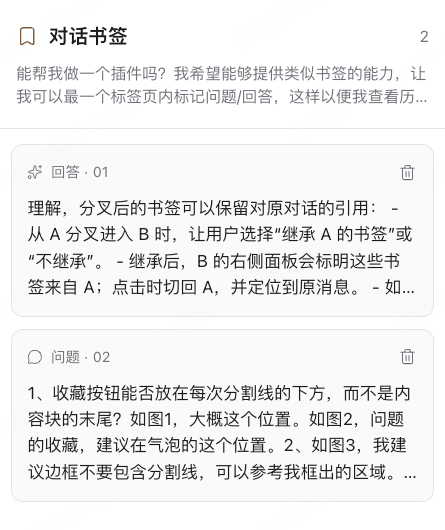

# Paseo 对话书签

[English](README.md)

收藏 Paseo 中的问题和回答，通过右侧书签面板或左侧历史轴，快速找回原文。



## 功能

- 一键收藏问题或回答。
- 在右侧按对话顺序查看内容摘要，点击即可跳转，也可直接移除书签。
- 跳转后短暂高亮原文；左侧历史轴用金色刻度标出已收藏的轮次。
- 分叉新标签页时，可选择继承原对话的书签。继承书签保留来源，在分叉中移除不会影响原对话。
- 原标签页关闭后，可重新打开历史对话并定位；原对话被删除后保留摘要，并提示不可用。

## 安装

支持 Paseo **0.15.x** 的桌面和网页客户端，插件界面跟随 Paseo 的语言设置；选择“跟随系统”时随系统切换。支持简体中文和英文，其他语言回退到英文。暂不支持原生手机客户端。

从本仓库直接安装：

```sh
paseo plugin add git:sylviaxiang424/paseo-bookmarks
```

## 使用

1. 鼠标移到消息上，点击书签图标。回答的图标位于起始分割线下方；问题的图标位于气泡右上方外侧。收藏后图标保持金色。
2. 点击工作区顶部或输入框旁的 **书签**，打开右侧面板。
3. 点击摘要定位原文，点击垃圾桶移除。问题只高亮气泡内部；回答只高亮正文，不包含分割线和操作栏。
4. 分叉进入新标签页时，选择 **继承书签** 或 **不继承**。

## 数据与兼容

书签保存在所连接 daemon 主机的 `$PASEO_HOME/plugin-data/paseo-bookmarks/bookmarks.json`，未设置 `PASEO_HOME` 时使用 `~/.paseo`。数据包含消息标识、来源信息和最多 800 字符的本地文本摘要。摘要不由 AI 生成；插件不请求外部服务，也不需要账号或令牌。卸载插件不会删除该数据文件。

面板和导航使用 Paseo 插件 API；消息按钮、历史轴标记和精确定位还依赖 Paseo 0.15.x 界面适配，宿主界面变化时可能需要更新。定位会等待历史加载，必要时自动重试一次；来源无法访问或宿主界面不兼容时，仍可能无法跳转。

## 开发

```sh
npm ci --ignore-scripts
npm run typecheck
npm test
paseo plugin install /absolute/path/to/paseo-bookmarks
```

修改后先运行检查，再执行 `paseo plugin reload paseo-bookmarks` 重载，无需单独构建。运行时依赖由 Paseo 提供。

`client/` 包含面板、导航和网页适配；`server/` 负责本地存储；`shared/` 定义数据与 RPC 契约。测试覆盖持久化、分叉继承、直接移除、布局边界，以及未加载或重新挂载的历史消息定位。
